# Encore v1 — Distributed Live-Events Ticketing & Resale Platform
## Final System Design Specification

> **Version boundary:** Encore v1 is the complete distributed-systems foundation. It does not include ML, GenAI, RAG, or agents. Those belong to Encore v2.
>
> **Primary engineering problem:** millions of users competing for a small amount of ticket inventory during flash-sale events while preserving correctness, reliability, and acceptable latency.

---

# 1. Product Overview

Encore combines:

- primary event discovery and ticket sales
- high-concurrency flash-sale ticketing
- virtual waiting rooms
- ticket resale / exchange
- payment and wallet services
- notifications and live chat
- livestream and VOD
- organizer file sharing
- location-aware discovery
- distributed background jobs
- service deployment
- monitoring and operational tooling

The project is designed to demonstrate the system-design concepts across the ByteByteGo curriculum through one coherent product rather than disconnected toy systems.

---

# 2. Scope and Versioning

## Encore v1 includes

### Core distributed systems

- horizontal scaling
- load balancing
- API gateway
- rate limiting
- consistent hashing
- distributed cache
- key-value storage
- unique ID generation
- queues
- asynchronous processing
- distributed locking
- reservation systems
- payments
- digital wallet
- matching engine
- sharding
- replication
- object storage
- observability
- job scheduling
- deployment

### Product capabilities

- event search
- autocomplete
- event feed
- event crawler
- notifications
- chat
- email
- media/VOD
- organizer documents
- proximity search
- nearby friends
- venue routing
- leaderboard
- ad-click aggregation
- URL shortening

## Explicitly deferred to v2

- demand prediction
- recommendations using ML
- fraud ML
- resale anomaly ML
- pricing intelligence
- RAG
- LLM applications
- AI operations agent
- incident response agent
- customer support agent
- discovery agent

---

# 3. Requirements

## 3.1 Functional Requirements

1. Browse and search events, artists, and venues.
2. Search with autocomplete.
3. Purchase tickets for normal and flash-sale events.
4. Reserve seats without double-selling.
5. Release expired holds automatically.
6. Process idempotent payments.
7. Support wallet/store credit.
8. Resell tickets using a secondary marketplace.
9. Match resale bids and asks using price-time priority.
10. Send notifications through push/SMS/email.
11. Support live event chat.
12. Stream events and provide replay/VOD.
13. Share organizer documents with permissions and versions.
14. Find nearby events.
15. Find friends attending nearby events.
16. Provide simplified venue routing/ETA.
17. Run scheduled background jobs.
18. Deploy Encore services using a controlled deployment pipeline.
19. Provide operator metrics, logs, tracing, alerts, and leaderboards.

## 3.2 Non-Functional Requirements

### Consistency

Ticket inventory must be strongly consistent.

> A seat must never be sold twice.

### Availability

Search, feeds, notifications, and some discovery data can tolerate a few seconds of staleness.

### Scalability

The platform must absorb extreme peak-to-trough traffic changes caused by flash sales.

### Performance

Target sub-100 ms reads for hot seat-availability checks where feasible.

### Reliability

Retries and failures must not lose tickets or cause duplicate financial operations.

### Durability

Purchases, refunds, and resale trades require a durable audit trail.

---

# 4. Capacity Estimation

Example design targets:

| Metric | Normal | Flash Sale Peak |
|---|---:|---:|
| Active events on sale | 5,000 | 1 major event |
| Concurrent buyers | 50,000 | 2,000,000 |
| Checkout QPS | 500 | 50,000 |
| Seat-read QPS | 5,000 | 500,000 |
| Peak/trough ratio | — | ~1000x |

Estimated storage:

```text
50M event/ticket records/year
× ~2 KB metadata
≈ 100 GB/year relational metadata
```

Media is substantially larger and belongs in object storage rather than the transactional database.

## Key observation

The hardest problem is not raw storage size.

It is:

> **thousands or millions of clients contending over a small number of hot inventory records at the same time.**

---

# 5. High-Level Architecture

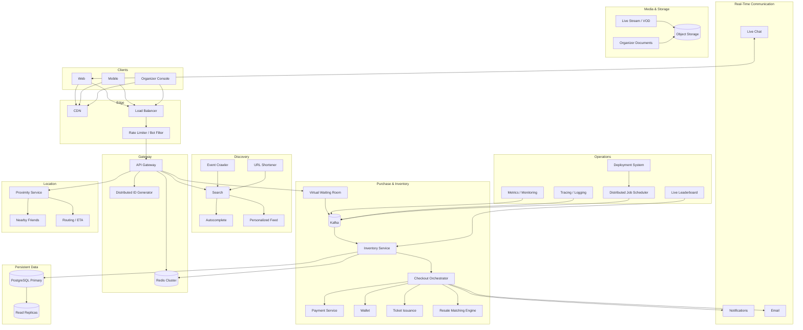

---

# 6. Architecture Evolution

Encore is intentionally designed as an evolution rather than a "microservices from day one" system.

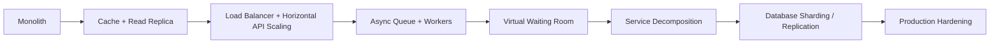

For each stage document:

```text
Problem
   ↓
Observed bottleneck
   ↓
Architectural change
   ↓
Tradeoff
   ↓
Measured result
```

---

# 7. Cluster 1 — Foundation

## 7.1 API Gateway

Responsibilities:

- authentication
- authorization
- routing
- API versioning
- request validation
- request IDs
- rate-limit integration
- consistent error format

Example:

```text
/api/v1/events
/api/v1/search
/api/v1/inventory
/api/v1/orders
/api/v1/payments
/api/v1/resale
```

---

# 8. Load Balancing

Multiple stateless API instances:

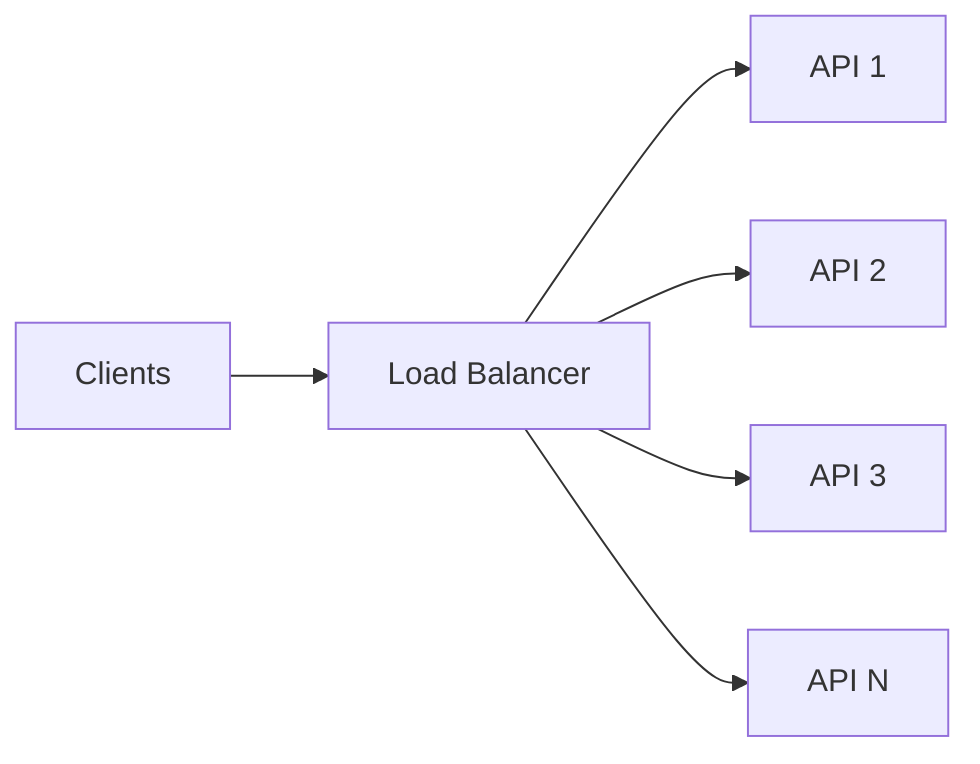

Requirements:

- health checks
- graceful removal
- horizontal scaling
- no critical local state

---

# 9. Rate Limiting

Use multiple controls.

## User/IP/device token bucket

Example:

```text
100 requests/minute
10-request burst
```

## Checkout protection

Example rule:

```text
>3 checkout attempts/minute
→ challenge/throttle
```

## Design

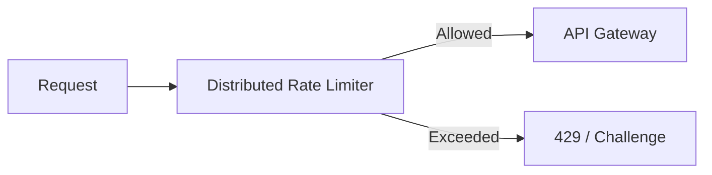

The limiter belongs at the edge so compromised application services cannot bypass it.

---

# 10. Consistent Hashing

Redis is partitioned using consistent hashing.

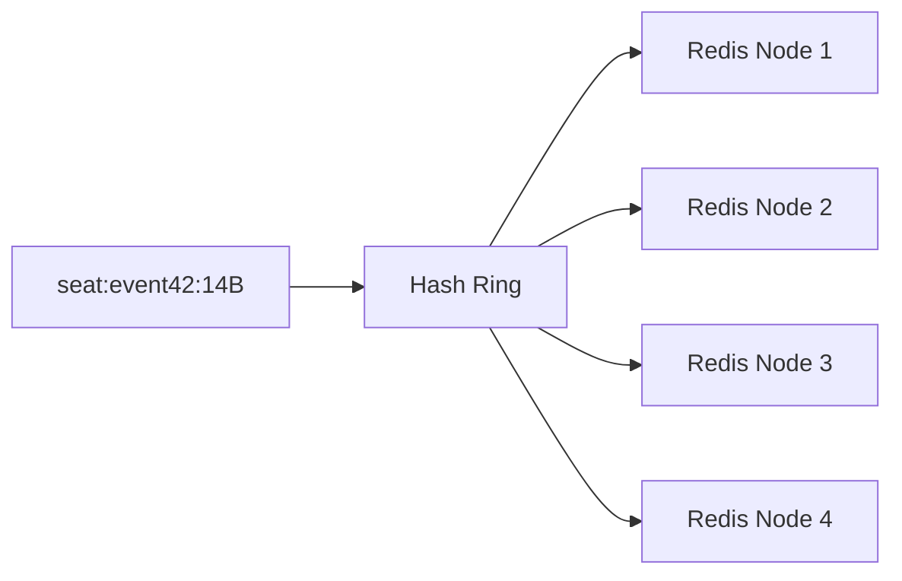

Use virtual nodes to reduce uneven distribution when nodes are added/removed.

Applications:

- seat cache
- session data
- hot event metadata
- short-lived reservation state

---

# 11. Distributed Key-Value Store

Redis is the fast KV layer for:

```text
seat:event_742:14B
session:user_123
hold:seat_14B
ratelimit:user_123
queue:user_123
```

Example:

```text
GET seat:event_742:14B
→ AVAILABLE
```

Seat holds use TTLs.

---

# 12. Distributed ID Generator

Use a Snowflake-style ID.

```text
timestamp | worker/shard ID | sequence
```

IDs are used for:

- orders
- tickets
- payments
- trades
- jobs
- queue positions
- request/event IDs

Sortable IDs are useful for queue fairness and audit ordering.

---

# 13. Database Strategy

## PostgreSQL

Authoritative transactional data:

```text
users
events
venues
seats
inventory
orders
payments
wallet_transactions
tickets
resale_orders
trades
jobs
audit_events
```

## Read replicas

Use replicas for read-heavy, non-critical paths:

```text
event browsing
search metadata
analytics
historical views
```

## Primary

Writes and strongly consistent inventory operations remain on the primary/sharded inventory database.

---

# 14. Database Sharding

Shard high-volume inventory by event ID.

```text
hash(event_id) → shard
```

Example:

```text
Event A → Shard 1
Event B → Shard 4
Event C → Shard 2
Event D → Shard 1
```

The goal is to isolate hot events and distribute workload.

---

# 15. Cluster 2 — Flash-Sale Purchase & Inventory

This is the flagship subsystem.

## Core flow

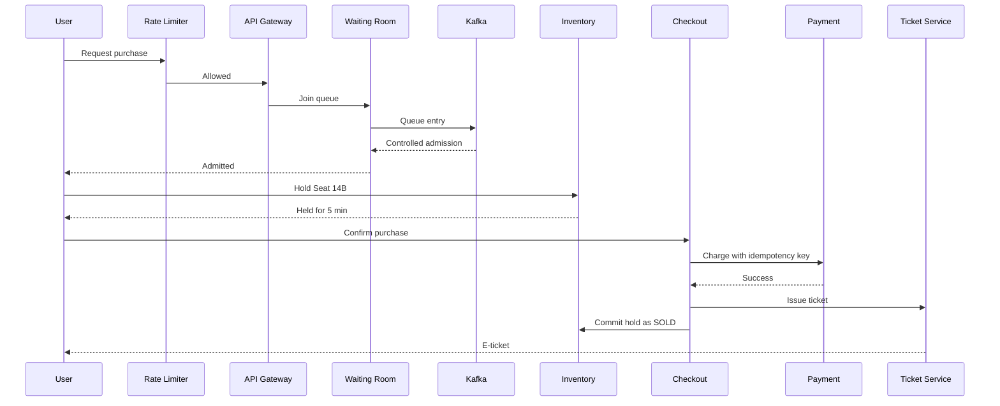

---

# 16. Virtual Waiting Room

The waiting room solves the thundering-herd problem.

Instead of:

```text
2M users
   ↓
PostgreSQL
```

use:

```text
2M users
   ↓
Rate Limiter
   ↓
Waiting Room
   ↓
Controlled admission
   ↓
Inventory
```

Admission rate should be limited according to downstream capacity.

---

# 17. Distributed Message Queue

Kafka acts as the asynchronous backbone.

Topics can include:

```text
ticket.purchase.requested
ticket.purchase.completed
ticket.expired
payment.requested
payment.completed
resale.order.created
notification.requested
media.transcode.requested
job.scheduled
deployment.requested
audit.events
```

Use:

- partitioning
- consumer groups
- offsets
- retries
- dead-letter topics
- at-least-once delivery

---

# 18. Seat Reservation and Distributed Locking

Two possible implementations can be evaluated.

## Baseline

PostgreSQL:

```sql
SELECT ...
FOR UPDATE;
```

## Optimized hot-path experiment

Redis:

```text
SETNX hold:event_742:seat_14B user_123 EX 300
```

The hold expires after 5 minutes.

The authoritative transition is:

```text
AVAILABLE
   ↓
HELD
   ↓
SOLD
```

or:

```text
HELD
   ↓
expired
   ↓
AVAILABLE
```

No seat can simultaneously belong to two successful orders.

---

# 19. Checkout Orchestrator

Checkout coordinates multiple services.

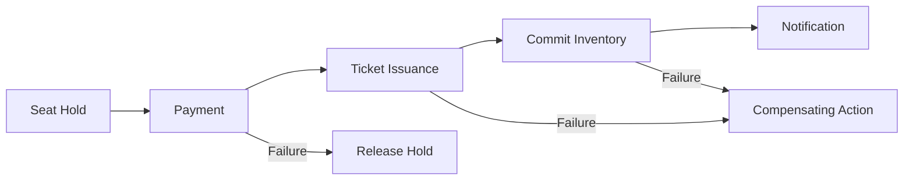

Use a saga-style orchestration approach.

---

# 20. Idempotent Payments

Every payment request carries an idempotency key.

```text
Idempotency-Key: pay_abc123
```

If a client retries:

```text
Request 1 → Payment succeeds
Response lost

Request 2 → same key

Result → existing successful payment
```

Never charge twice.

---

# 21. Wallet / Store Credit

Organizations/users can hold platform credit.

Example:

```text
Cancellation
   ↓
Wallet Credit
   ↓
Future Ticket Purchase
```

Wallet operations require:

- ACID transactions
- immutable ledger entries
- unique transaction IDs
- idempotency
- reconciliation

---

# 22. Resale Marketplace / Matching Engine

Once a user owns a ticket, it can be listed.

```text
SELL:
ticket_123 @ ₹1500

BUY:
event_742 @ ₹1500
```

Match using:

1. best price
2. earliest order at that price

This is price-time priority.

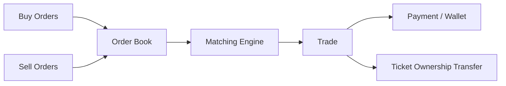

The order book can be centralized per event for simplicity and auditability.

---

# 23. Cluster 3 — Discovery

## Search

Support:

- events
- artists
- venues
- categories
- location
- date
- price

## Search Autocomplete

Use a trie or equivalent prefix index:

```text
ro
├── rock
├── rohit
└── roadshow
```

Rank suggestions using historical popularity.

---

# 24. Event Crawler

Ingest partner/venue event data.

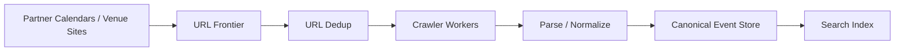

Requirements:

- deduplication
- retries
- rate limits
- crawl prioritization
- normalization
- malformed-input handling

---

# 25. URL Shortener

Create short links for events and tickets:

```text
enc.re/E7a2
```

Map:

```text
short code → event/ticket resource
```

Use:

- Base62
- collision-safe generation
- cache
- redirect metrics

---

# 26. Event Feed

Provide:

```text
Events you may like
Trending near you
Artists you follow
```

Use a hybrid model.

### Normal accounts

Fan-out-on-write.

### Celebrity/mega-artist accounts

Fan-out-on-read.

This avoids writing one event into millions of feeds unnecessarily.

---

# 27. Ad Click Aggregation

Sponsored listings produce:

```text
impression
click
event_id
organizer_id
timestamp
campaign_id
```

Stream through Kafka and aggregate in windows.

Metrics:

- impressions
- clicks
- CTR
- CPC billable clicks
- spend

---

# 28. Cluster 4 — Real-Time Communication

## Notification Service

Channels:

- push
- SMS
- email
- in-app

Events:

```text
ON_SALE
PRICE_DROP
WAITLIST_MOVED
PURCHASE_COMPLETE
TICKET_DELIVERY
EVENT_CHANGE
```

Use at-least-once delivery with deduplication.

---

# 29. Chat Service

Live event chat:

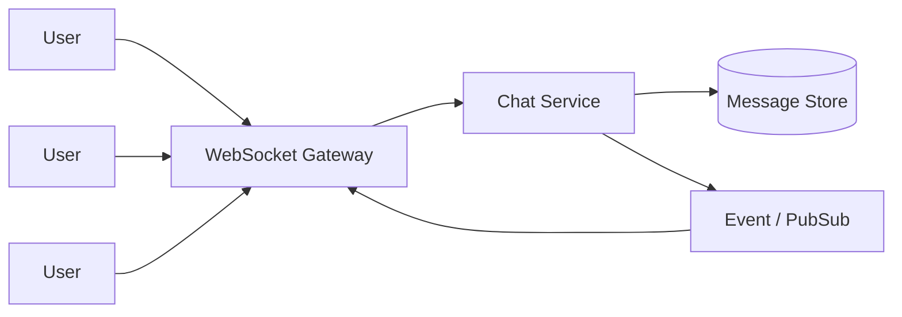

Features:

- presence
- message ordering
- room membership
- moderation hooks
- reconnect handling
- delivery status

---

# 30. Email Service

Checkout must not wait on email delivery.

```text
Checkout
   ↓
email.requested
   ↓
Kafka
   ↓
Email Worker
   ↓
Provider
```

Support:

- retries
- backoff
- dead-letter queue
- templates
- deduplication

---

# 31. Cluster 5 — Media and Storage

## Object Storage

S3-compatible architecture:

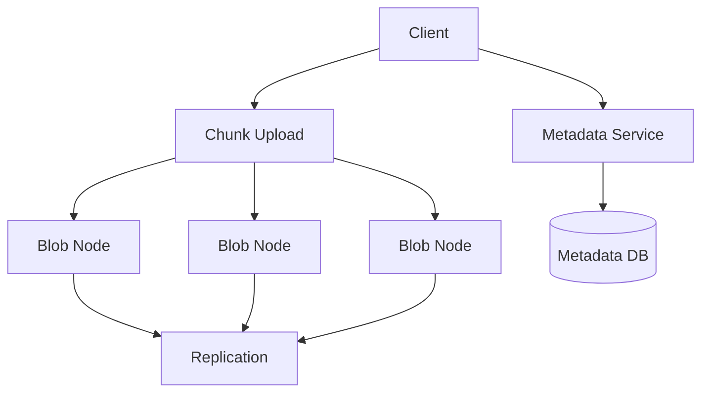

Store:

- event posters
- organizer documents
- recordings
- transcoded media

Metadata remains separate from blob data.

---

# 32. Organizer Document Sharing

Features:

- upload
- folders
- versioning
- permissions
- download
- restore

Example permissions:

```text
OWNER
EDITOR
VIEWER
```

---

# 33. Livestream / VOD

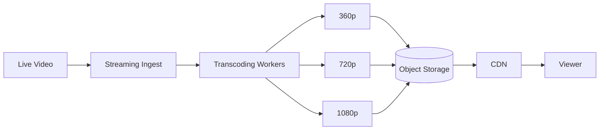

Use asynchronous transcoding jobs.

---

# 34. Cluster 6 — Location

## Proximity Service

Use geohash or spatial indexing.

```text
User:
Hyderabad

Query:
events within 10 km
```

Return nearby events without scanning the entire event table.

---

# 35. Nearby Friends

Build on the same spatial index.

```text
User location
   ↓
Nearby attendees
   ↓
Privacy filter
   ↓
Friend relationship
   ↓
Nearby friends
```

Location updates should be batched rather than emitted every second.

---

# 36. Venue Routing / ETA

Simplified graph:

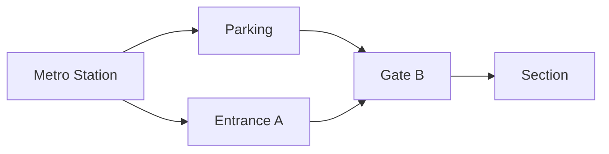

Use:

- shortest-path search
- route weights
- event-time congestion assumptions

This is deliberately smaller than Google Maps.

---

# 37. Cluster 7 — Operations

## Metrics

Track:

```text
request rate
P50/P95/P99 latency
error rate
queue depth
Kafka lag
Redis hit rate
DB latency
seat contention
payment failures
checkout success rate
waitlist size
```

## Monitoring

Prometheus + Grafana.

Example alert:

```text
checkout_p95 > 2 seconds
for 60 seconds
```

---

# 38. Distributed Job Scheduler

This is an explicit v1 component.

Use it for:

- seat-hold expiration
- event ingestion
- notification campaigns
- media transcoding
- analytics aggregation
- periodic cleanup
- scheduled reports

Architecture:

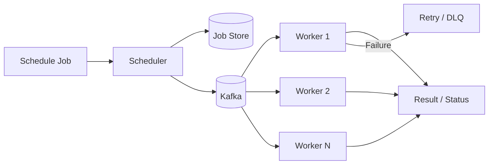

Support:

- one-time jobs
- delayed jobs
- recurring jobs
- priorities
- retries
- leases
- dead-letter queue

---

# 39. Code Deployment System

Encore includes a basic internal deployment pipeline.

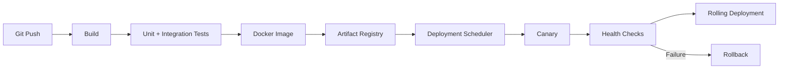

Deployment strategies:

- rolling deployment
- canary deployment
- rollback
- health checks
- deployment history

The deployment system should never bypass health checks.

---

# 40. Live Leaderboard

Create a real-time ranking such as:

```text
Fastest-selling events
```

Redis sorted set:

```text
ZADD event_sales 1200 event_742
ZADD event_sales 900 event_513
```

Then:

```text
ZREVRANGE event_sales 0 9
```

---

# 41. Cross-Cutting Data Flow

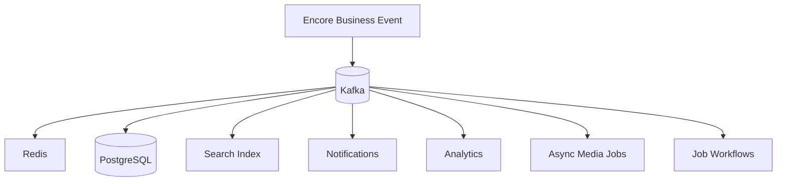

Kafka is the integration backbone while PostgreSQL remains the source of truth for transactional state.

---

# 42. Consistency Model

## Strong consistency

Use for:

- seat inventory
- ticket ownership
- payment state
- wallet ledger
- resale settlement

## Eventual consistency

Acceptable for:

- search index
- personalized feed
- trending events
- notification counters
- leaderboard
- analytics

This is an explicit product/design decision.

---

# 43. Reliability Patterns

Encore v1 uses:

- retries with exponential backoff
- idempotency keys
- dead-letter queues
- distributed locks
- TTLs
- health checks
- circuit breakers where appropriate
- graceful degradation
- replicated data
- audit logs
- compensating transactions
- asynchronous processing

---

# 44. Failure Scenarios

## Worker failure

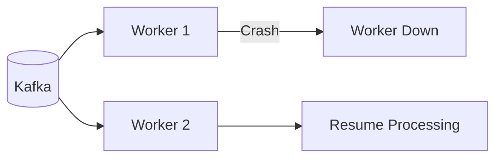

Kafka retains the work until another consumer processes it.

## Redis failure

Non-critical cached reads fall back to authoritative services where possible.

## Payment timeout

```text
Seat Held
   ↓
Payment timeout
   ↓
Retry using same idempotency key
   ↓
Success OR release hold
```

## Deployment failure

Canary fails health checks:

```text
Canary
  ↓
Unhealthy
  ↓
Rollback
```

## Seat-hold expiration

```text
HELD
  ↓ TTL expires
AVAILABLE
```

---

# 45. Observability Architecture

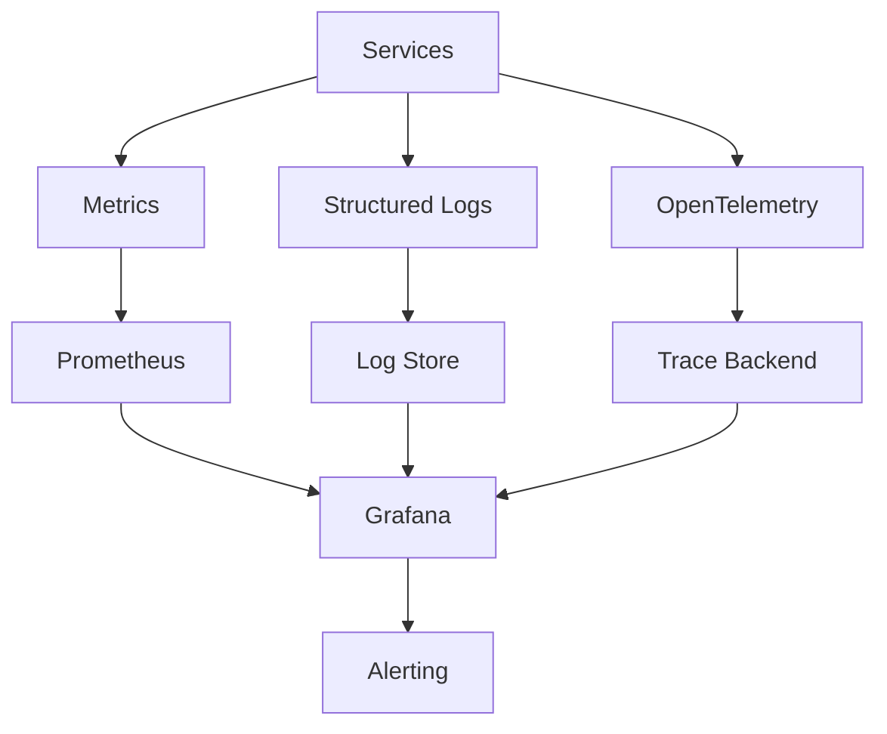

Use a shared trace ID across:

```text
request
→ queue message
→ worker
→ checkout
→ payment
→ notification
```

---

# 46. Security

## Authentication

- JWT/session tokens
- API keys for service clients

## Authorization

RBAC:

```text
CUSTOMER
ORGANIZER
SUPPORT
OPERATIONS
ADMIN
```

## Additional controls

- TLS
- input validation
- secret management
- least privilege
- audit logging
- rate limiting
- webhook verification

---

# 47. API Design

Examples:

```http
GET /api/v1/events
GET /api/v1/events/{event_id}
GET /api/v1/events/{event_id}/seats

POST /api/v1/waiting-room/join
GET /api/v1/waiting-room/{entry_id}

POST /api/v1/holds
DELETE /api/v1/holds/{hold_id}

POST /api/v1/orders
GET /api/v1/orders/{order_id}

POST /api/v1/payments
GET /api/v1/payments/{payment_id}

POST /api/v1/resale/orders
GET /api/v1/resale/order-book/{event_id}

POST /api/v1/jobs
GET /api/v1/jobs/{job_id}

POST /api/v1/deployments
GET /api/v1/deployments/{deployment_id}
```

Use versioned APIs.

---

# 48. Core Database Model

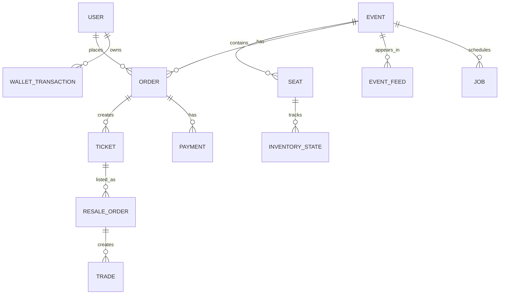

Representative entities:

```text
User
Event
Venue
Seat
InventoryState
Order
Payment
Ticket
WalletTransaction
ResaleOrder
Trade
Job
Deployment
AuditEvent
```

---

# 49. Primary Event Flows

## Primary purchase

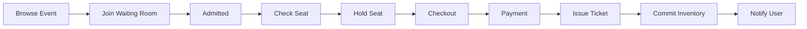

## Resale

```mermaid
flowchart LR
    A[Owner Lists Ticket] --> B[Order Book]
    C[Buyer Places Bid] --> B
    B --> D[Matching Engine]
    D --> E[Trade]
    E --> F[Payment]
    F --> G[Ownership Transfer]
    G --> H[Notification]
```

---

# 50. ByteByteGo Concept Coverage

| Concept | Encore v1 mapping |
|---|---|
| Scale from zero to millions | Architecture evolution + horizontal scaling |
| Back-of-envelope estimation | Capacity planning |
| System-design framework | Requirements → estimation → architecture → tradeoffs |
| Rate limiter | Edge/API Gateway |
| Consistent hashing | Redis partitioning |
| Key-value store | Redis |
| Unique ID generator | Snowflake-style service |
| URL shortener | Event/ticket short links |
| Web crawler | Event ingestion crawler |
| Notification system | Notification service |
| News feed | Personalized/trending event feed |
| Chat system | Event live chat |
| Search autocomplete | Trie/prefix search |
| YouTube-style system | Livestream + VOD + transcoding |
| Google Drive-style system | Organizer document storage/share |
| Proximity service | Events near me |
| Nearby friends | Nearby attendees/friends |
| Google Maps-style concepts | Venue routing/ETA |
| Distributed cache | Redis + CDN |
| Distributed locking | Seat reservation |
| Job scheduler | Distributed Scheduler |
| Hotel reservation | Seat hold/expiration |
| Ticket booking | Primary ticket purchase |
| Payment system | Payment service |
| Digital wallet | Wallet/store credit |
| Stock exchange | Resale order book/matching |
| Distributed message queue | Kafka |
| Distributed file system | Chunked replicated object storage |
| Code deployment | Internal deployment pipeline |

---

# 51. Key Architectural Tradeoffs

| Decision | Choice | Reason | Cost |
|---|---|---|---|
| Seat consistency | Strong | Never double-sell | Lower throughput |
| Feed/search | Eventual | Better scalability | Slight staleness |
| Waiting room | Queue-based | Protect database | Added latency |
| Inventory lock | DB lock baseline + Redis experiment | Correctness + performance comparison | Complexity |
| Resale matching | Centralized per event | Simple/auditable | Not a global exchange |
| Notifications | At-least-once + dedup | Prefer no missed alerts | Possible duplicates |
| Cache | Cache-aside/TTL | Protect DB and lower latency | Stale values |
| API services | Stateless | Horizontal scaling | External state stores needed |
| Storage | Object storage for blobs | Cost/scaling | Separate metadata layer |
| Deployments | Canary + rollback | Reduce blast radius | More deployment complexity |

---

# 52. What Must Be Fully Implemented

## Priority 1 — Flagship

```text
API Gateway
Load Balancer
Rate Limiter
Redis
Consistent Hashing
Distributed ID Generator
Kafka
Virtual Waiting Room
Inventory Service
Seat Hold / Release
Distributed Lock
Checkout
Idempotent Payment
Ticket Issuance
Resale Matching Engine
```

## Priority 2 — Infrastructure

```text
PostgreSQL
Read Replicas
Sharding experiment
Distributed Job Scheduler
Deployment Pipeline
Prometheus
Grafana
Structured Logging
OpenTelemetry
```

## Priority 3 — Smaller production slices

```text
Search
Autocomplete
Event Crawler
Feed
Notifications
Chat
Email
Object Storage
Documents
Media/VOD
Proximity
Nearby Friends
Routing
Leaderboard
Ad Click Aggregation
URL Shortener
```

---

# 53. Load Testing Strategy

Use k6 or Locust.

## Test 1 — Normal traffic

```text
500 checkout QPS
5K seat reads/sec
```

## Test 2 — Flash sale

```text
2M simulated buyers
50K checkout attempts/sec
500K seat reads/sec
```

## Test 3 — Hot-seat contention

Many clients target the same seat/event.

Goal:

```text
successful buyers for a seat = 1
double-sells = 0
```

## Test 4 — Payment retries

Inject:

```text
timeouts
5xx
duplicate requests
slow responses
```

## Test 5 — Worker failure

Kill consumers during a live workload.

Verify:

```text
no lost jobs
no duplicate settlement
eventual recovery
```

---

# 54. Performance Metrics to Publish

Do not invent these values before running tests.

Record:

```text
Throughput
P50 latency
P95 latency
P99 latency
Error rate
Cache hit rate
Kafka lag
DB CPU
Redis latency
Seat contention rate
Queue wait time
Payment success rate
```

Example result format:

```text
Flash Sale Load Test

Concurrent users: X
Checkout throughput: X req/s
P95 checkout latency: X ms
P99 checkout latency: X ms
Double-sells: 0
Payment duplicate charges: 0
Kafka lag peak: X
Redis hit rate: X%
```

---

# 55. Recommended Tech Stack

| Layer | Technology |
|---|---|
| Backend | FastAPI or Go |
| Frontend | React / Vite |
| Queue | Kafka |
| Cache/KV | Redis Cluster |
| Database | PostgreSQL |
| Search | OpenSearch / Elasticsearch |
| Object Storage | S3 / MinIO |
| Metrics | Prometheus |
| Dashboards | Grafana |
| Tracing | OpenTelemetry |
| Containers | Docker |
| Orchestration | Kubernetes |
| CI/CD | GitHub Actions |
| Load Testing | k6 / Locust |

For the first implementation, keep the hot checkout path in one language/runtime. Optimize for clarity before adding unnecessary polyglot complexity.

---

# 56. Repository Structure

```text
encore/
├── apps/
│   ├── api-gateway/
│   ├── inventory-service/
│   ├── waiting-room/
│   ├── checkout-service/
│   ├── payment-service/
│   ├── wallet-service/
│   ├── resale-engine/
│   ├── search-service/
│   ├── notification-service/
│   ├── chat-service/
│   ├── scheduler/
│   └── deployment-service/
│
├── packages/
│   ├── id-generator/
│   ├── event-contracts/
│   ├── auth/
│   ├── rate-limiter/
│   ├── observability/
│   └── common/
│
├── infrastructure/
│   ├── docker/
│   ├── kubernetes/
│   ├── kafka/
│   ├── redis/
│   └── postgres/
│
├── tests/
│   ├── unit/
│   ├── integration/
│   ├── contract/
│   └── load/
│
├── docs/
│   ├── architecture/
│   ├── decisions/
│   ├── incidents/
│   ├── benchmarks/
│   └── api/
│
└── frontend/
```

---

# 57. Development Roadmap

## Phase 0 — Design Foundation

- requirements
- capacity estimation
- architecture
- database schema
- API contracts
- event contracts
- ADRs

## Phase 1 — Foundation

- API gateway
- authentication
- rate limiter
- Redis
- ID generator
- PostgreSQL
- Docker

## Phase 2 — Flash Sale Core

- waiting room
- Kafka
- inventory
- seat holds
- TTL release
- distributed lock
- checkout

## Phase 3 — Payments and Resale

- payment abstraction
- idempotency
- wallet
- ticket issuance
- order book
- matching engine

## Phase 4 — Reliability

- retries
- DLQ
- circuit breaking where appropriate
- health checks
- graceful shutdown
- failure injection

## Phase 5 — Scale

- horizontal API scaling
- read replicas
- Redis clustering
- inventory sharding
- autoscaling

## Phase 6 — Observability

- Prometheus
- Grafana
- OpenTelemetry
- structured logs
- alerts
- dashboards

## Phase 7 — Supporting Services

- search
- autocomplete
- crawler
- feed
- notifications
- chat
- email
- media
- location
- object storage

## Phase 8 — Scheduler and Deployment

- distributed scheduler
- worker execution
- retry/DLQ
- deployment pipeline
- canary
- rollback

## Phase 9 — Benchmark and Document

- load tests
- failure tests
- architecture evolution
- tradeoff documentation
- benchmark report
- final diagrams

---

# 58. Definition of Done for v1

Encore v1 is complete when:

### Correctness

```text
No double-sold seats
No duplicate successful payments
No lost jobs after worker failure
No invalid ownership transfers
```

### Scalability

```text
API can scale horizontally
Queue absorbs bursts
Cache protects hot reads
Inventory can be partitioned
```

### Reliability

```text
Retries work
TTL cleanup works
DLQ works
Rollback works
Canary rollback works
```

### Observability

```text
Every request has a trace ID
Queue depth is visible
Checkout latency is visible
Payment failures are visible
Inventory contention is visible
```

### Evidence

```text
Load-test results
Failure-test results
Architecture evolution document
ADR/tradeoff records
API documentation
Architecture diagrams
```

---

# 59. Final Project Narrative

> **Encore is a distributed live-events ticketing and resale platform designed around the hardest problem in ticket commerce: millions of users competing for limited inventory during flash sales.**
>
> The platform uses API gateways, distributed rate limiting, consistent hashing, Redis, Kafka, virtual waiting rooms, strongly consistent inventory reservations, idempotent payments, wallet transactions, a resale matching engine, object storage, search, real-time communication, distributed scheduling, deployment automation, and end-to-end observability.
>
> The system evolves from a simple architecture into a horizontally scalable distributed platform, with explicit tradeoffs between consistency, availability, latency, and complexity.

---

# 60. V1 → V2 Boundary

```mermaid
flowchart LR
    V1[Encore v1\nDistributed Platform]
    V2[Encore v2\nIntelligence Layer]

    V1 -->|Kafka Events| V2
    V2 -->|Recommendations / Risk / Insights| V1
    V2 -->|Controlled API / Tool Calls| V1
```

V1 owns the truth.

V2 learns from V1 and interacts through controlled interfaces.

This separation must remain intact.

---

# 61. Final Resume Positioning

### Encore — Distributed Ticketing & Resale Platform

Recommended resume description after implementation and measurement:

> Designed and built a high-concurrency ticketing and resale platform with virtual waiting rooms, Kafka-based asynchronous processing, Redis caching, distributed seat reservations, idempotent payments, wallet transactions, and a price-time resale matching engine. Added horizontal scaling, database partitioning, observability, distributed scheduling, and canary deployments; validated the system with flash-sale load and failure testing.

Only replace the placeholders with **measured results from actual tests**.

---

# 62. V1 Is Frozen

The following are considered part of the final v1 design:

```text
✓ Foundation
✓ Rate limiting
✓ Consistent hashing
✓ KV/cache
✓ Unique IDs
✓ API gateway
✓ Load balancing
✓ PostgreSQL
✓ Replicas
✓ Sharding
✓ Waiting room
✓ Kafka
✓ Inventory
✓ Distributed locks
✓ Reservations
✓ Checkout
✓ Payments
✓ Wallet
✓ Ticket issuance
✓ Resale matching
✓ Search
✓ Autocomplete
✓ Crawler
✓ Feed
✓ Notifications
✓ Chat
✓ Email
✓ Streaming/VOD
✓ Object storage
✓ Document sharing
✓ Proximity
✓ Nearby friends
✓ Venue routing
✓ Job scheduler
✓ Deployment
✓ Monitoring
✓ Leaderboard
✓ Security
✓ Load testing
✓ Failure testing
```

**ML, GenAI, RAG, and agents are intentionally excluded from v1 and belong to Encore v2.**
