# Encore v2 — AI/ML & Agentic Intelligence Layer
## Final System Design Specification

> **Version boundary:** Encore v1 is frozen as the distributed ticketing and resale platform. Encore v2 adds ML, GenAI, RAG, and agents **on top of v1** without changing its core distributed-systems architecture.
>
> **Design principle:** AI services consume Encore events/data and interact with Encore through versioned APIs and controlled tools. AI does not directly mutate critical ticket inventory, payment state, or financial ledgers.

---

# 1. What Encore v2 Adds

Encore v2 turns the v1 platform into an intelligent event-commerce platform with:

1. Event Demand Prediction
2. Personalized Event Recommendations
3. Bot / Fraud Risk Detection
4. Resale-Market Anomaly Detection
5. Demand / Pricing Intelligence
6. AI Operations Agent
7. AI Incident Response Agent
8. AI Customer Support Agent
9. AI Event Discovery Agent
10. RAG / Knowledge Assistant

These capabilities are designed as separate services so they can evolve independently.

---

# 2. V1 → V2 Architecture

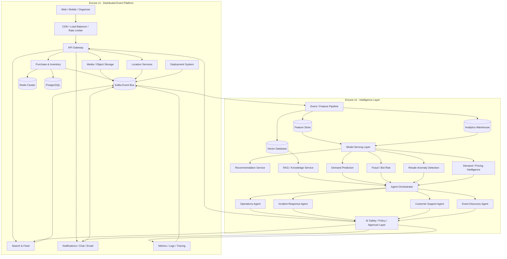

---

# 3. Core V2 Design Rules

## 3.1 V1 remains the source of truth

Critical state stays in v1:

- ticket inventory
- seat ownership
- payment status
- wallet balances
- resale settlement
- order state

AI can recommend or flag. It does not become the authoritative transaction database.

## 3.2 Event-driven ML architecture

Encore v1 already produces Kafka events. V2 reuses that backbone.

Example event:

```json
{
  "event_type": "TICKET_PURCHASED",
  "event_id": "evt_92831",
  "user_id": "usr_184",
  "event_id_ref": "event_742",
  "ticket_id": "tkt_112",
  "price": 1499,
  "timestamp": "2026-08-23T10:12:31Z"
}
```

The intelligence layer builds features from streams instead of repeatedly querying transactional databases.

## 3.3 AI must be observable

Every prediction and agent action should have:

- model/version ID
- input feature snapshot or feature references
- confidence/risk score
- latency
- decision/action
- outcome where available
- trace ID
- timestamp

---

# 4. Intelligence Data Plane

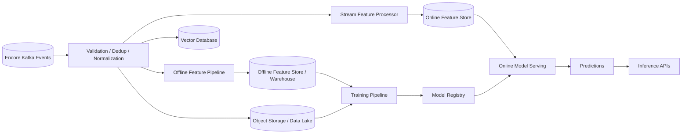

### Main infrastructure

- Kafka for event transport
- PostgreSQL for transactional metadata
- Redis for online low-latency features/cache
- Object storage for raw datasets, training artifacts and model files
- Feature store for reusable ML features
- Warehouse/lake for offline analytics
- Vector database for semantic retrieval
- Model registry for versioning
- Model serving API for production inference

---

# 5. AI/ML Capability 1 — Event Demand Prediction

## Goal

Predict future demand for an event before inventory becomes scarce.

## Example output

```json
{
  "event_id": "event_742",
  "forecast_horizon": "1h",
  "predicted_ticket_demand": 18250,
  "predicted_sellout_probability": 0.91,
  "confidence": 0.87,
  "model_version": "demand-xgb-v3"
}
```

## Features

- tickets sold per minute
- tickets remaining
- searches
- event page views
- cart additions
- waiting-room size
- conversion rate
- historical demand
- event category
- artist popularity
- venue capacity
- day of week
- time until event
- price
- resale activity
- geography

## Initial model

Start with:

- XGBoost / LightGBM
- regression for demand
- classification for sellout probability

Later experiments can compare temporal deep-learning models.

## Integration

The prediction service feeds:

```text
Demand Prediction
       |
       +--> Organizer dashboard
       +--> Waiting-room capacity planning
       +--> Inventory alerts
       +--> Pricing intelligence
       +--> Recommendation ranking
```

## Important boundary

The model does **not** directly change seat inventory or payment state.

---

# 6. AI/ML Capability 2 — Personalized Event Recommendations

## Goal

Recommend events based on user behavior and event attributes.

## Version progression

### V2.1 Content-based

Use:

- artist
- genre
- venue
- location
- price range
- time/day
- event embeddings

### V2.2 Collaborative

Use:

- users who viewed similar events
- users who bought similar events
- user-event interaction matrix

### V2.3 Hybrid

Combine:

```text
User history
+
Event content
+
Collaborative signals
+
Demand signals
+
Real-time context
```

## Architecture

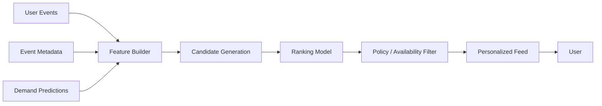

## Example

```text
User preference:
Rock + Hyderabad + Weekend + ₹500-₹3000

Recommended:
1. Indie Rock Night      0.94
2. Stadium Rock Festival 0.89
3. Acoustic Sessions      0.76
```

The recommendation system must filter out:

- sold-out events
- inaccessible events
- prohibited content
- events outside configured user preferences

---

# 7. AI/ML Capability 3 — Bot / Fraud Risk Detection

## Goal

Detect automated ticket scalping and suspicious purchase behavior.

## Features

- requests/minute
- unique accounts/device
- IP diversity
- browser/device fingerprint
- queue behavior
- checkout attempts
- payment failures
- account age
- purchasing velocity
- repeated seat-hold patterns
- geographic anomalies

## Architecture

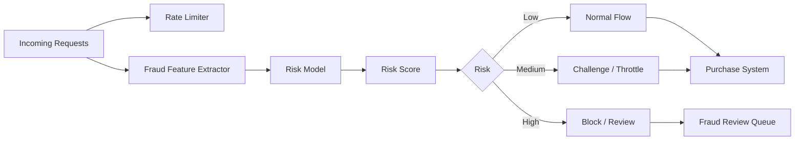

## Design principle

ML complements the v1 rate limiter.

The existing deterministic controls remain:

```text
Rate limits
CAPTCHA
IP/device rules
```

ML adds behavioral risk scoring.

---

# 8. AI/ML Capability 4 — Resale-Market Anomaly Detection

## Goal

Detect unusual resale behavior.

## Signals

- price movement
- order-book imbalance
- trade velocity
- repeated account interactions
- ticket concentration
- sudden price spikes
- abnormal cancellation patterns
- correlated accounts

## Example

```text
Normal:
120 -> 125 -> 130 -> 135

Detected:
120 -> 250 -> 600 -> 900
```

The system produces:

```json
{
  "event_id": "event_742",
  "risk_type": "PRICE_ANOMALY",
  "risk_score": 0.96,
  "evidence": [
    "5.2x price increase",
    "8.1x volume spike"
  ]
}
```

The matching engine itself remains deterministic. ML flags suspicious conditions; it does not silently rewrite orders.

---

# 9. AI/ML Capability 5 — Demand / Pricing Intelligence

## Goal

Provide organizers with forecasts and pricing recommendations.

The system combines:

```text
Demand prediction
+
Sellout probability
+
Inventory remaining
+
Resale-market signals
+
Historical events
+
Venue capacity
```

## Example

```text
Current ticket price: ₹1500

Forecast:
Demand: Very High
Sellout probability: 92%
Inventory remaining: 8%

Suggested organizer action:
Consider releasing additional inventory.
```

For v2, keep this as **decision support** rather than automatic dynamic pricing.

This makes the system easier to evaluate and avoids turning an ML model into an uncontrolled financial decision-maker.

---

# 10. AI Capability 6 — AI Operations Agent

## Goal

Allow an operator to ask questions about Encore infrastructure using real system tools.

Example:

> "Why is checkout latency high for Event 742?"

The agent can call:

```text
get_checkout_p95()
get_queue_depth()
get_kafka_lag()
get_redis_hit_rate()
get_db_latency()
get_payment_latency()
get_error_rate()
get_recent_deployments()
```

## Architecture

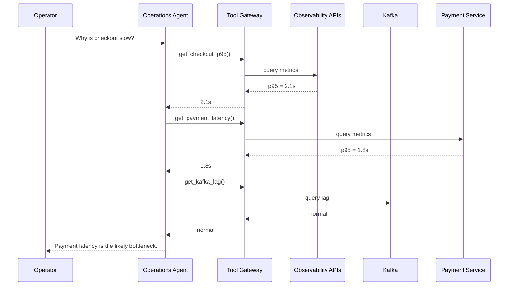

The agent explains its reasoning using actual telemetry.

---

# 11. AI Capability 7 — Incident Response Agent

## Goal

Investigate incidents automatically and produce a structured diagnosis.

Example trigger:

```text
checkout_p95 > 2s for 60s
```

Agent workflow:

```text
1. Confirm alert
2. Check API error rate
3. Check Kafka lag
4. Check Redis
5. Check DB
6. Check payment provider
7. Check recent deployments
8. Compare against baseline
9. Identify likely root cause
10. Recommend remediation
```

## Safe architecture

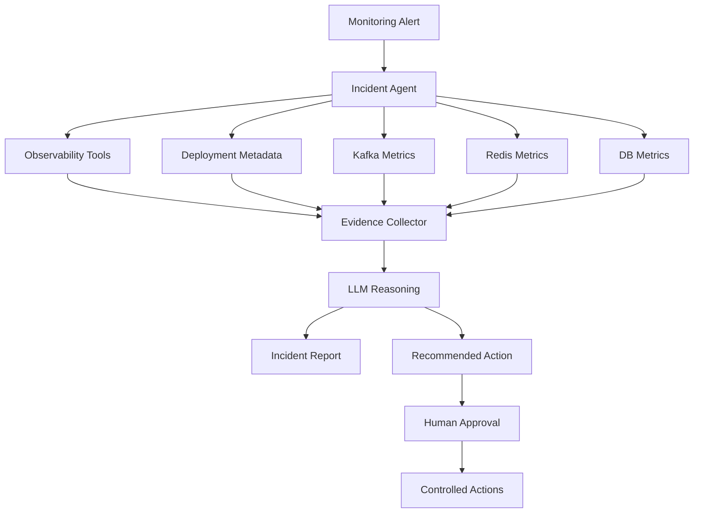

### V2.1

Read-only.

### V2.2

Approved actions:

- scale workers
- restart unhealthy worker
- pause deployment
- enable circuit breaker

No direct autonomous modification of inventory or payments.

---

# 12. AI Capability 8 — Customer Support Agent

## Goal

Answer customer questions using actual Encore state.

Example:

> "Why haven't I received my ticket?"

The agent calls:

```text
get_order(order_id)
get_payment_status(order_id)
get_ticket_status(order_id)
get_email_delivery_status(order_id)
```

Then:

```text
Payment: SUCCESS
Ticket: ISSUED
Email: FAILED

Response:
Your ticket was issued successfully, but email delivery failed.
```

## Key design rule

The LLM never invents transaction state.

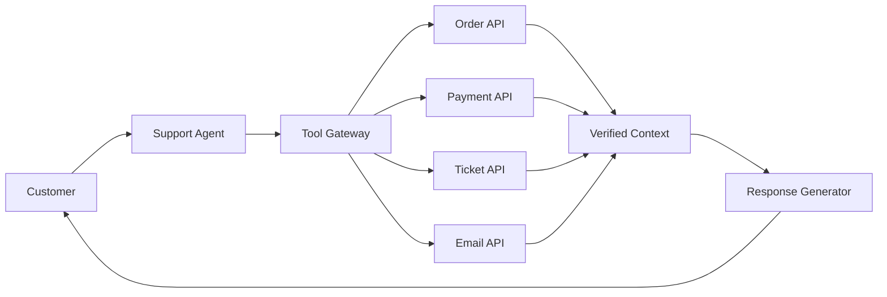

---

# 13. AI Capability 9 — Event Discovery Agent

## Goal

Allow natural-language event discovery.

Example:

> "Find rock concerts near Hyderabad next weekend below ₹2000."

The agent decomposes the request:

```text
Intent:
    event type = rock
    location = Hyderabad
    date = next weekend
    max price = ₹2000
```

Then calls:

```text
search_events()
get_nearby_events()
get_event_prices()
check_availability()
rank_events()
```

## Architecture

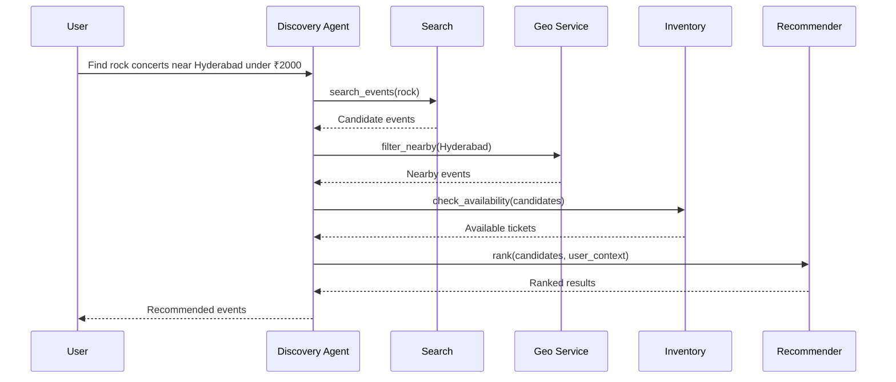

This agent is grounded in Encore's actual search, location, inventory and recommendation services.

---

# 14. AI Capability 10 — RAG / Knowledge Assistant

## Goal

Answer questions using Encore's trusted knowledge sources.

Documents may include:

- refund policies
- venue rules
- event FAQs
- organizer contracts
- ticket restrictions
- accessibility policies
- support documentation

## Pipeline

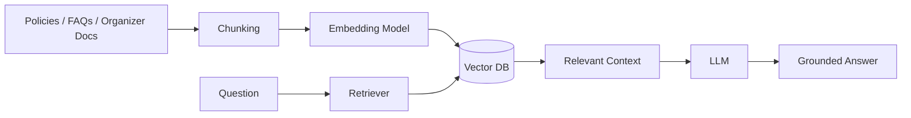

## Retrieval requirements

- document ACL filtering
- metadata filters
- source references
- confidence checks
- no answer when trusted context is missing

For organizer-private documents:

```text
User permission
      ↓
ACL filter
      ↓
Retriever
      ↓
LLM
```

The vector database must never bypass Encore's authorization model.

---

# 15. Unified Agent Platform

All four agents should share one common platform.

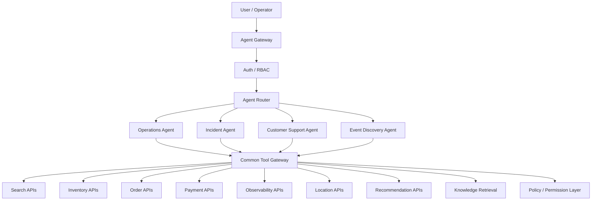

---

# 16. Tool Gateway

Agents must not receive direct database credentials.

Instead:

```text
Agent
  ↓
Tool Gateway
  ↓
Policy Check
  ↓
Typed API
  ↓
Encore Service
```

Example tool:

```json
{
  "name": "get_order_status",
  "description": "Return verified order state",
  "input": {
    "order_id": "ord_123"
  }
}
```

Example mutation tool:

```json
{
  "name": "pause_deployment",
  "description": "Pause an active rollout",
  "requires_approval": true
}
```

---

# 17. AI Safety / Governance Layer

Critical because Encore handles payments and ticket ownership.

## Never allow the LLM to directly:

- update seat inventory
- transfer ownership without validation
- modify wallet balance
- settle resale trades
- issue arbitrary refunds
- change financial ledger entries
- execute raw SQL
- access another user's private documents

Instead:

```text
LLM
 ↓
Structured Tool Call
 ↓
Authorization
 ↓
Validation
 ↓
Optional Human Approval
 ↓
Domain Service
 ↓
Audit Log
```

---

# 18. ML Training Lifecycle

```mermaid
flowchart LR
    EVENTS[Kafka Events] --> DATA[Data Lake / Warehouse]
    DATA --> FEAT[Feature Engineering]
    FEAT --> TRAIN[Model Training]
    TRAIN --> EVAL[Offline Evaluation]

    EVAL -->|Pass| REG[Model Registry]
    EVAL -->|Fail| TRAIN

    REG --> STAGING[Staging Model]
    STAGING --> SHADOW[Shadow / Canary]
    SHADOW --> PROD[Production Serving]

    PROD --> MON[Model Monitoring]
    MON --> DRIFT[Drift / Quality Detection]
    DRIFT --> RETRAIN[Retraining Trigger]
    RETRAIN --> TRAIN
```

---

# 19. Model Registry

Every model should have:

```text
model_name
version
training_data_version
feature_version
code_version
metrics
created_at
status
deployment_stage
```

Example:

```text
demand-model:v3
recommendation-model:v7
fraud-model:v4
resale-anomaly-model:v2
```

Never overwrite a production model blindly.

---

# 20. Model Evaluation

## Demand Prediction

Metrics:

- MAE
- RMSE
- MAPE
- calibration of sellout probability

## Recommendation

Metrics:

- Precision@K
- Recall@K
- NDCG@K
- CTR
- conversion rate

## Fraud / Bot Detection

Metrics:

- precision
- recall
- F1
- false-positive rate
- PR-AUC

## Resale Anomaly Detection

Metrics:

- precision of flagged anomalies
- false-positive rate
- analyst confirmation rate

---

# 21. Agent Evaluation

Agents need different metrics.

## Tool correctness

```text
Did the agent choose the correct tool?
```

## Groundedness

```text
Did the answer use verified Encore data?
```

## Task completion

```text
Did the user's task actually get completed?
```

## Safety

```text
Did the agent avoid unauthorized actions?
```

## Hallucination rate

```text
How often did the agent state unsupported facts?
```

## Latency / cost

```text
P50 agent latency
P95 agent latency
Average tokens/request
Cost/request
```

---

# 22. Agent Trace

Every agent interaction should be observable.

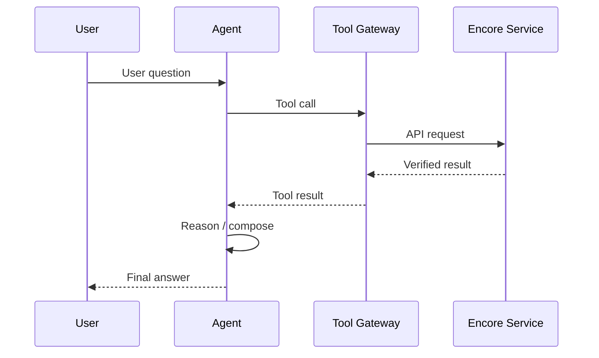

Capture:

```text
trace_id
agent_id
model_version
tool_name
tool_latency
tool_result_status
tokens
final_answer
approval_state
```

---

# 23. AI + Encore Feedback Loops

The strongest v2 characteristic is that the system continuously improves from real platform behavior.

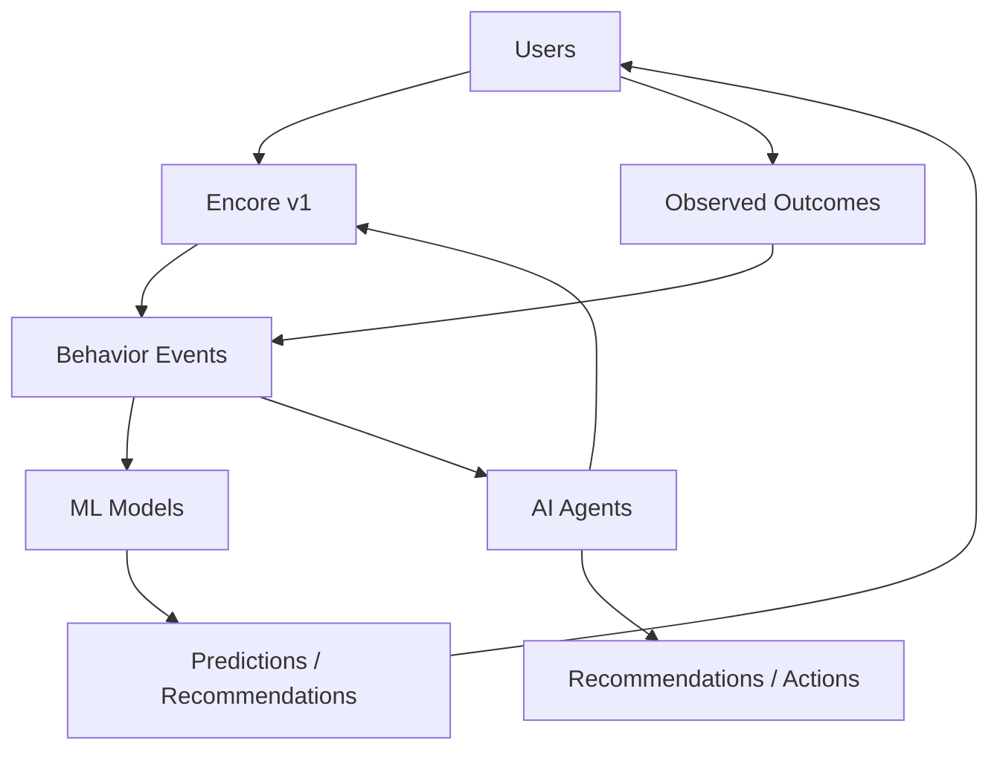

Examples:

```text
Recommendations
    ↓
User clicks
    ↓
Purchase
    ↓
Training data

Demand forecast
    ↓
Predicted sellout
    ↓
Actual sellout
    ↓
Model evaluation

Fraud score
    ↓
Challenge
    ↓
Confirmed fraud / false positive
    ↓
Retraining data
```

---

# 24. V2 Deployment Model

AI services should scale independently from the ticketing core.

```text
Encore Core
    |
    +-- API services: 10 replicas
    |
    +-- Inventory: 8 replicas
    |
    +-- Kafka: cluster
    |
    +-- Redis: cluster
    |
    +-- ML inference: 6 replicas
    |
    +-- Recommendation inference: 4 replicas
    |
    +-- Agent workers: 3 replicas
```

During a flash sale, the ticketing path gets priority.

AI workloads must not be allowed to starve inventory or checkout resources.

---

# 25. Failure Handling

## ML model unavailable

Fallback:

```text
ML unavailable
     ↓
Cached prediction
     ↓
Rule-based fallback
```

## Recommendation service unavailable

Fallback:

```text
Personalized feed unavailable
     ↓
Popular / nearby events
```

## Agent unavailable

Fallback:

```text
Agent unavailable
     ↓
Normal search / support interface
```

## Vector database unavailable

Fallback:

```text
RAG unavailable
     ↓
Keyword search / standard knowledge base
```

The transactional ticketing system continues operating.

---

# 26. AI-Specific SLOs

Example targets:

| Service | Target |
|---|---|
| Demand inference P95 | < 200 ms |
| Recommendation P95 | < 150 ms |
| Fraud scoring P95 | < 100 ms |
| Search agent P95 | < 3 sec |
| Support agent P95 | < 4 sec |
| Operations agent P95 | < 5 sec |
| RAG retrieval P95 | < 250 ms |

These are design targets, not claimed measurements.

---

# 27. V2 Build Phases

## Phase 1 — Data & ML Foundation

Build:

- Kafka event contracts
- data pipeline
- feature generation
- model registry
- experiment tracking
- demand prediction
- recommendation baseline

## Phase 2 — Trust & Risk

Build:

- bot/fraud model
- resale anomaly detection
- pricing intelligence
- model monitoring

## Phase 3 — RAG

Build:

- document ingestion
- chunking
- embeddings
- vector DB
- ACL-aware retrieval
- grounded answers

## Phase 4 — Agents

Build:

- common agent gateway
- tool gateway
- operations agent
- customer support agent
- event discovery agent
- incident response agent

## Phase 5 — Production Hardening

Build:

- model canary deployments
- drift monitoring
- agent evaluation
- audit logs
- approval workflows
- cost controls
- fallback paths

---

# 28. Final V2 Architecture

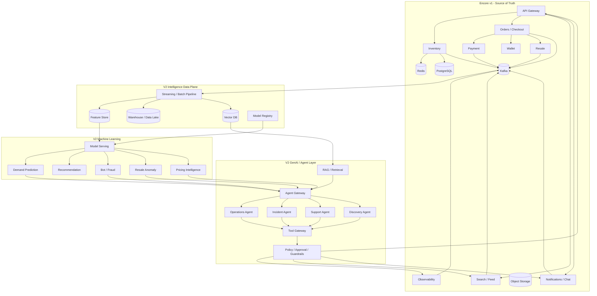

---

# 29. Final Project Definition

## Encore v1

**Distributed Ticketing & Resale Platform**

Focus:

- system design
- distributed systems
- scalability
- concurrency
- reliability
- payments
- queues
- caching
- reservations
- observability

## Encore v2

**AI/ML & Agentic Intelligence Layer**

Focus:

- predictive ML
- recommender systems
- fraud detection
- anomaly detection
- pricing intelligence
- RAG
- LLM tool use
- AI agents
- incident intelligence
- AI evaluation
- model lifecycle
- AI safety

---

# 30. Final Resume Architecture

```text
                    ENCORE
                       │
        ┌──────────────┴──────────────┐
        │                             │
     V1 CORE                        V2 AI
        │                             │
 Distributed Systems              ML / AI
        │                             │
 ├─ Rate Limiting              ├─ Demand Prediction
 ├─ Waiting Room               ├─ Recommendations
 ├─ Kafka                      ├─ Fraud Detection
 ├─ Redis                      ├─ Resale Anomaly
 ├─ Consistent Hashing         ├─ Pricing Intelligence
 ├─ Reservations               ├─ RAG
 ├─ Payments                   ├─ Operations Agent
 ├─ Wallet                     ├─ Incident Agent
 ├─ Resale Engine              ├─ Support Agent
 ├─ Object Storage             └─ Discovery Agent
 ├─ Search
 ├─ Chat
 ├─ Media
 ├─ Location
 ├─ Scheduler
 ├─ Deployment
 └─ Observability
```

### The key architectural story

**v1 creates the distributed platform and the data.**

**v2 learns from that data and reasons over the platform.**

**v2 does not replace v1. It builds on it.**

That separation gives Encore a very strong progression:

> **Distributed Systems → ML → GenAI → Agentic Systems**

---

# 31. Recommended V2 Technology Stack

| Layer | Technology |
|---|---|
| Core backend | FastAPI / Go |
| Event bus | Kafka |
| Cache / online features | Redis |
| Transaction DB | PostgreSQL |
| Object storage | S3 / MinIO |
| Search | Elasticsearch / OpenSearch |
| ML | Python + scikit-learn / XGBoost |
| Deep learning (optional) | PyTorch |
| Feature store | Feast |
| Model tracking | MLflow |
| Model serving | FastAPI / BentoML / KServe |
| Vector DB | pgvector / Qdrant |
| Embeddings | sentence-transformers / API model |
| LLM | configurable provider/local model |
| Agent orchestration | custom tool-calling layer / LangGraph |
| Monitoring | Prometheus + Grafana |
| Tracing | OpenTelemetry |
| Containers | Docker |
| Orchestration | Kubernetes |
| Load testing | k6 / Locust |

---

# 32. What Success Looks Like

Do not judge v2 by how many AI libraries it contains.

The final artifact should demonstrate:

```text
1. A real distributed system
2. Real event-driven data
3. Real ML prediction
4. Real recommendation
5. Real fraud/anomaly detection
6. Real retrieval
7. Real tool-using agents
8. Real observability
9. Real evaluation
10. Real failure handling
```

Most importantly, each AI component should answer:

> **What problem does it solve in Encore?**

rather than:

> **Where can I add an LLM?**

---

## Final version

**Encore v1 remains frozen. Encore v2 adds all 10 AI/ML/agent capabilities above as an intelligence layer.**

The v2 design is therefore not a second unrelated project; it is a **production-style evolution of the same distributed platform**, which gives you a much stronger story for software-engineering, AI/ML, and agent-oriented roles.
